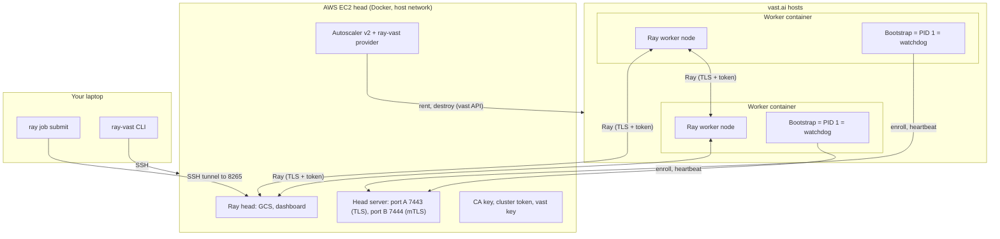
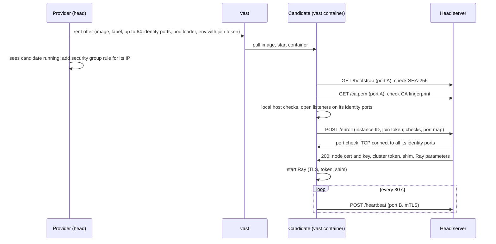

# Architecture

ray-vast runs a Ray cluster with the head on AWS EC2 and the workers on vast.ai containers.
The nodes talk over the public internet, across NAT, with TLS and a token. There is no VPN and no overlay network.

## The head

The head is one EC2 instance in a region that you choose. It runs one Docker container, `ray-vast-head`, with the host network.

- **Why EC2.** A vast instance can stop at any time, and on many hosts its IP can change. If the head stops, the cluster is lost. EC2 gives a stable head.
- **Security groups.** The head's security groups allow SSH from your IP only. They allow the Ray and head server ports from worker IPs only. So a DDoS on the internet can stop single workers, but not the cluster.
- **One image.** The head runs your image plus the ray-vast package (a derived image that `up` builds on the head). So Python and Ray are the same on all nodes.
- **One process does the work.** The provider runs in the Ray monitor process, next to the autoscaler. The head server is a thread in the provider. The provider keeps all its state in memory.
- **No CPU for tasks.** The head declares `CPU: 0`. Tasks and actors with resources run on the workers.

## The provider

The provider is a Ray autoscaler v2 node provider (`ray_vast.provider.VastNodeProvider`).

- When Ray needs a node, the autoscaler asks the provider. The provider makes a slot at once, and rents candidates for it.
- A reconcile pass runs every 10 seconds. It lists the vast instances, adds security group rules for new IPs, ends candidates that pass a time limit, and destroys instances that it does not know (the orphan sweep).
- When the provider starts, it destroys every instance with the cluster label (the start-up sweep). A new head has a new Ray GCS, so old workers cannot join it again.

## The workers

A worker is a vast container that has enrolled and runs Ray.

- The container command is a short bootloader. It downloads the bootstrap from the head, checks its SHA-256, and starts it.
- The bootstrap runs as PID 1. It checks the host, enrolls, starts Ray, and then acts as the watchdog.
- The workers need no sshd. The head never connects to a worker over SSH.

Read [Enrollment and the join token](#enrollment-and-the-join-token) and [Worker life cycle and the watchdog](#worker-life-cycle-and-the-watchdog).

## NAT and the identity ports

A vast container is behind NAT. vast maps some host ports into the container.

Each worker asks vast for up to 64 ports: the identity ports from 70000 up. The count is the smaller of 64 and the offer's `direct_port_count`. vast gives a host port P for each, and maps P to the same P in the container.
Ray advertises the public IP of the host and the ports P. So other nodes reach the worker directly.

| Identity port | Use |
|---|---|
| 70000 | Ray node manager |
| 70001 | Ray object manager |
| 70002 | Metrics export |
| 70003 | Dashboard agent gRPC |
| 70004 | Dashboard agent HTTP (job port, 127.0.0.1 only) |
| 70005 | Runtime-env agent (127.0.0.1 only) |
| 70006 up to 70063 | Ray worker processes: the mapped identity ports minus 6, at most 58 (fewer with a process limit) |

The provider adds `direct_port_count >= 10 + min(CPU, 54)` to every offer query: the 6 fixed ports, 4 ports for the helper processes of the Ray libraries, and one port for each CPU. A host with 20 direct ports gives 20 identity ports, so at most 14 worker ports.
Before a candidate enrolls, the head connects to all its identity ports from outside (the port check).

## The networking shim

Ray binds and connects to the address that it advertises. In a container, that address is the host's public IP, which the container does not own.
Without help, the bind fails (`Errno 99`), and the Ray node stops.

ray-vast loads a small `LD_PRELOAD` library, the shim, into all Ray processes on the head and on the workers:

- A bind to the public IP becomes a bind to the private IP.
- A connect to the node's own public IP becomes a connect to the private IP. So the node does not need hairpin NAT.
- The job port and the runtime-env agent port bind to 127.0.0.1 only. So the token never goes over the network for these ports.

The head sends the shim to each worker when the worker enrolls.

## Head ports

| Port | Use | Open to |
|---|---|---|
| 22 | SSH | Your IP |
| 6379 | Ray GCS | Worker IPs |
| 6380–6383 | Ray node manager, object manager, metrics, agent gRPC | Worker IPs |
| 6384, 6385 | Job port, runtime-env agent | 127.0.0.1 only |
| 8265 | Ray dashboard | 127.0.0.1 only (use `ray-vast dashboard`) |
| 10002–10100 | Ray worker processes | Worker IPs |
| 7443 | Head server: bootstrap, CA, enrollment (TLS) | Worker IPs |
| 7444 | Head server: heartbeat, reports (mTLS) | Worker IPs |

The provider adds one security group rule (all TCP) for each worker IP, before the worker enrolls. It removes the rule when no worker or candidate uses the IP any more.

## Enrollment and the join token

A new vast instance has no cluster secrets. Enrollment is the step where it proves its identity to the head and gets them.

### Why workers enroll themselves

vast shows the command and the environment of an instance in its metadata. The container log is at a public URL.
So ray-vast cannot put the cluster secrets in the rental request.

ray-vast does not push secrets over SSH either. That needs sshd, apt and `sudo` in the image, and many images do not have them.

So each worker pulls its secrets from the head, after it proves who it is.

### The steps

1. **Rent.** The provider makes a new join token for each candidate: 32 random bytes. It puts the token in the env of the rental request. The env also has the head IP, the head ports, the SHA-256 of the bootstrap and the SHA-256 of the CA.
2. **Bootloader.** The container command is a short script with no secrets. It finds a Python that can `import ray`, downloads the bootstrap from the head, checks its SHA-256, and starts it as PID 1.
3. **Pin the CA.** The bootstrap downloads the CA certificate and checks its SHA-256 against the value in the env. From then on, it verifies the head with this CA.
4. **Host checks.** The bootstrap checks its host:
    - the egress IP equals the public IP that vast gives;
    - the container has no `NET_RAW` or `NET_ADMIN` capability;
    - the container has its own network namespace;
    - `/dev/shm` is empty.
5. **Enroll.** The bootstrap sends `POST /enroll` with its instance ID, the join token, the check results, its port map, its CPU affinity and CPU quota, and its GPU count.
6. **Head checks.** The head accepts the request only for a known candidate, from its own public IP, with its own join token, once. Then it checks the host check results, the GPU count and the CPU cores. Then it connects to all its identity ports from outside (the port check).
7. **Secrets.** If a slot of the node type is free, the head makes a node key and certificate. It answers with the certificate, the key, the cluster token, the shim and the Ray parameters (the GCS address and the `CPU` of the node type). The worker already has the CA: it pinned it in step 3.
8. **Ray.** The bootstrap removes the secrets from Ray's environment, and starts Ray. Ray joins the head with TLS and the token.

### The join token

The join token proves that an `/enroll` request comes from the instance that the provider rented. It is the same pattern as `kubeadm join --token`.

- The token is valid for one instance ID, only from that instance's public IP, and only for one enrollment.
- It becomes invalid when the instance enrolls, or when the provider ends the candidate.
- The head compares tokens in constant time.
- Nobody logs the token. The bootstrap removes it from the environment of Ray.

Who can read the token: your vast account, your own workers, and the host of the candidate. Co-tenants and the internet cannot. Read [Security model](../security.md).

### Refusals

A refusal before a valid join token destroys nothing: an unknown instance, an instance that already enrolled, a wrong source IP, or a wrong token.
So a stranger cannot kill your candidates with junk requests. The provider's time limits end such candidates.

After a valid token, a failed check destroys the candidate:

| Failure | Blocklist kind for the host |
|---|---|
| Capability, network namespace or `/dev/shm` check | `security`, 30 days |
| A GPU count other than the node type's `GPU` | `security`, 30 days |
| Fewer CPU cores than 90 % of the node type's `CPU` | `security`, 30 days |
| Egress IP check or port check | `network`, 1 day |
| No free slot | none |

The blocklist is in the provider's memory. It is lost at `down`.

### Node certificates

Each node certificate is bound to its instance. It has the worker's public IP and the URI `rayvast:instance/<instance id>`.
On port B, the head checks both. So a worker cannot send heartbeats or reports for another instance.

Each cluster has its own CA and its own cluster token. The CA key stays on the head.

## Worker life cycle and the watchdog

This page tells how a worker starts, runs and ends. It also tells why a worker destroys itself.

### From demand to worker

1. **Demand.** A task, an actor or a placement group needs resources that no node has. The autoscaler chooses a node type and asks the provider for n nodes.
2. **Slots.** The provider makes n slots at once. The n slots of one call are one request.
3. **Rent.** The provider rents up to `candidate_factor` × n candidates (default 2 × n). Read [How the provider picks an offer](#how-the-provider-picks-an-offer).
4. **Pull.** vast pulls the image and starts the container.
5. **Enroll.** The first candidates that enroll fill the slots. Read [Enrollment and the join token](#enrollment-and-the-join-token).
6. **Extra candidates.** When every slot of the request has a worker, the provider destroys the other candidates of the request.
7. **Ray.** The worker starts Ray with the `CPU` of the node type. The autoscaler matches the Ray node to the slot, and schedules the work.

In a live test with the CPU image, on a host that had the image in its cache:

- The candidate was `running` within 24 seconds of the rental.
- The candidate enrolled 26.7 seconds after the rental.
- Its Ray node was running 7.9 seconds after the enrollment.
- The provider destroyed the extra candidate 8.6 seconds after the enrollment.

A host without the image in its cache must pull the image first. For the 18 GB GPU image, this can take several minutes.

### How the provider picks an offer

- The provider searches with your offer query plus the fields that it adds. It asks vast for up to 100 offers.
- It sorts the offers by `dph_total`, in ascending order. So the cheapest offers come first. You cannot change the order.
- It skips the hosts on the blocklist. A host that fails a check goes on the blocklist for this cluster.
- It skips an offer that would take the total price above `max_dollars_per_hour`.

### Time limits for a candidate

| Limit | Value | Then |
|---|---|---|
| Pull | The pull limit. Read [Image size and the pull limit](../how-to/node-types.md#image-size-and-the-pull-limit). | The provider destroys the candidate. Blocklist `timeout`, 1 day. |
| Enrollment | 1 minute after the provider first sees the candidate `running` | The provider destroys the candidate. Blocklist `timeout`, 1 day. |
| Missing from vast's list | 60 seconds after the last list that showed it | The provider destroys the candidate. One list without it does not end it. |
| vast status `exited` or an error | at once | The provider destroys the candidate. Blocklist `network`, 1 day. |

**Rent-loop breaker.** The provider counts the slots of each node type that end with no worker. After 3 such slots in a row, it stops new launches of that node type for 10 minutes. A successful enrollment sets the count to 0.
Some faults affect every host, for example a broken image. The breaker stops the provider from renting instance after instance for such a fault.

### The watchdog

After it starts Ray, the bootstrap stays as PID 1 and becomes the watchdog.

- It sends a heartbeat to the head every 30 seconds, on port B (mTLS). The heartbeat carries the state of the process limit (pids and worker ports in use).
- The provider serves the heartbeat. So the heartbeat fails when the head is down, and also when only the provider is down.
- **Destroy, never exit.** When PID 1 of a vast container exits, vast starts the container again, and the instance keeps its full cost. So the watchdog always destroys its own instance through the vast API. It retries every 5 seconds until vast confirms.
- **Report first.** Before each destroy, the worker sends the reason to the head, and waits up to 10 seconds. vast keeps no container log after a destroy, so the head log is the only record.

### All the ways a candidate or a worker ends

| Trigger | Who acts | What happens |
|---|---|---|
| Idle for `idle_timeout_minutes` | Ray autoscaler | It drains the node. The provider destroys the instance. |
| No heartbeat success for 300 seconds | Worker | Report, then destroy. |
| A 403 answer to a heartbeat | Worker | Report, then destroy. |
| A 403 answer to `/enroll` | Candidate | Report, then destroy. |
| No enrollment within 10 minutes | Candidate | Report, then destroy. |
| Ray on the worker exits (for example, the head is lost for 60 seconds) | Worker | Report, then destroy. |
| `TERM`, `INT` or `HUP` to PID 1, or an error in the bootstrap | Candidate or worker | Report, then destroy. |
| A container restart | Worker | The head refuses the second enrollment. The worker destroys itself. |
| A failed token check | Head | The head destroys the worker. |
| No heartbeat for 5 minutes, seen by the head | Provider | Destroy. |
| The public IP of the instance changes | Provider | Destroy. A Ray node cannot change its address. |
| Missing from vast's list for 60 seconds after the last list that showed it | Provider | Destroy. A live instance that the provider forgets costs money. |
| vast status `exited` or an error | Provider | Destroy. |
| An instance with the cluster label that the provider does not know | Provider (orphan sweep) | Destroy. |
| `ray-vast down` | CLI | It terminates the head, then destroys every instance with the label. |

The bootloader also never exits. After a hash mismatch, or after 10 minutes of download failures, it destroys its own instance.

### Measured in a live test

A live test checked the self-destroy paths on real vast hosts. The times in the table are the measurements of that test. They are not limits. The limits are in the table above (for example, 300 seconds without a heartbeat).

| Test | Result |
|---|---|
| `SIGTERM` to PID 1 | The worker sent its report 0.5 seconds after the signal. vast listed the instance as gone 3.3 seconds after the signal at most. The Ray node was DEAD 31.6 seconds after the signal. |
| `SIGKILL`, `SIGQUIT`, `SIGUSR1`, `SIGUSR2`, `SIGCONT` to PID 1 | No effect after 120 seconds. The kernel drops `SIGKILL` to PID 1 from inside the container. |
| Heartbeats blocked on the head | The provider destroyed the worker 308.9 seconds after the last heartbeat (limit 270 to 330 seconds). The worker's own watchdog decided to destroy about 2 seconds later. |
| Reboot of a worker container | The head refused the second enrollment 8 seconds after the reboot. The instance was gone 0.7 seconds after the refusal at most. |

In every case, the head log had the reason. No instance was left after `ray-vast down`.

### When the head dies

ray-vast does not restart the head. If Ray's monitor dies, Ray stops the head container.
Then the heartbeats stop, and every worker destroys itself within 5 minutes.
The EC2 instance stays until you run `ray-vast down`. This is the same result as with a standard `ray up` cluster.

To recover, run `ray-vast down` and `ray-vast up`. The head keeps all state in memory, so the new head starts from zero.
