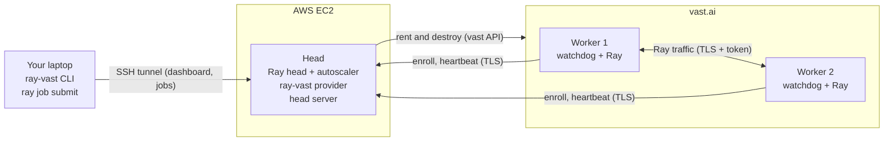

# ray-vast

ray-vast runs a Ray cluster with the head on AWS EC2 and the workers on vast.ai.
You keep the normal Ray workflow. Only the cluster commands change: `ray-vast up`, `ray-vast dashboard` and `ray-vast down`.

## Why

Usually, all nodes of a Ray cluster come from one cloud provider, such as AWS, GCP or Azure. The nodes are in one private network. In this network, they communicate simply and securely.

vast.ai is a market with cheaper GPUs. But vast instances have many constraints:

- An instance is not a VM. It is a container on a host machine. Many renters (co-tenants) can share one host.
- The instances communicate over the internet, not over a private network.
- An instance can stop at any time. Its IP address can change.
- The number of ports and the number of processes and threads have hard limits.

## What ray-vast does

- It implements a Ray autoscaler that works with these constraints.
- It solves the communication between the nodes over the internet.
- No critical endpoint is accessible without credentials. All traffic is encrypted. Co-tenants on the same host cannot read it.
- It evaluates the Ray libraries on vast: Core, Data, Train, Tune, Serve and RLlib. Read the results in [Ray libraries](libraries/index.md).

The vast host has root access to the worker container. Read the [Security model](security.md) before you use private data.

## How it works

1. `ray-vast up` makes the EC2 head and starts Ray on it.
2. Your job asks for resources. The autoscaler asks the ray-vast provider for a worker.
3. The provider rents vast instances. Each instance is a candidate. It downloads the bootstrap (a small program) from the head. The bootstrap checks the host and enrolls the candidate.
4. The enrolled candidate is now a worker. It joins Ray and runs your tasks.
5. Ray removes an idle worker after `idle_timeout_minutes`. A worker that loses the head destroys itself.

Read [Architecture](explanation/architecture.md) for the full picture.

## Links

- [Getting started](getting-started.md): your first cluster, step by step.
- [Submit jobs](libraries/jobs.md) and [Ray libraries](libraries/index.md): run your work.
- [How-to guides](how-to/node-types.md): choose GPUs, control cost, troubleshoot.
- [Reference](reference/cli.md): the CLI, the configuration, the limits.
- [How it works](explanation/architecture.md): the architecture, enrollment, the watchdog. And the [security model](security.md).
- Source code: [github.com/duc-ph/ray-vast](https://github.com/duc-ph/ray-vast).
