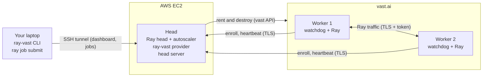

# ray-vast

ray-vast runs a Ray cluster with the head on AWS EC2 and the workers on vast.ai.

- The Ray head runs on one EC2 instance in your AWS account.
- The Ray autoscaler rents GPU workers from vast.ai when your jobs need them.
- The autoscaler removes the workers when they are idle.
- The workers talk to the head over the public internet, across NAT, with TLS and a token.
- You do not need a VPN or an overlay network.

You keep the normal Ray workflow. Only the cluster commands change: `ray-vast up`, `ray-vast dashboard` and `ray-vast down`.

## Who is it for

ray-vast is for you if:

- you use Ray, and you want cheap GPUs from the vast.ai market;
- you want a stable head that vast cannot stop;
- you accept the security model of rented hosts (read [Security model](security.md) first).

ray-vast is not for you if your data must not go to third-party hosts. A vast host has root access to the worker container.

## How it works



1. `ray-vast up` makes the EC2 head and starts Ray on it.
2. Your job asks for resources. The autoscaler asks the ray-vast provider for a worker.
3. The provider rents vast instances. Each instance is a candidate. It downloads the bootstrap (a small program) from the head. The bootstrap checks the host and enrolls the candidate.
4. The enrolled candidate is now a worker. It joins Ray and runs your tasks.
5. Ray removes an idle worker after `idle_timeout_minutes`. A worker that loses the head destroys itself.

Read [Architecture](explanation/architecture.md) for the full picture.

## Quick start

You need an AWS profile and a vast API key in `.env` (`VAST_API_KEY=<your key>`).
The full steps are in [Getting started](getting-started.md).

```bash
pip install ray-vast "ray[default]==2.59.*"
ray-vast up cluster.yaml --profile my-aws-profile
ray-vast dashboard cluster.yaml --profile my-aws-profile   # terminal 1: keep it open
```

In a second terminal:

```bash
export RAY_AUTH_MODE=token RAY_AUTH_TOKEN_PATH=~/.ray-vast/<cluster_name>/token   # the line that dashboard printed
ray job submit --address http://127.0.0.1:8265 --working-dir . -- python train.py
```

When you finish:

```bash
ray-vast down cluster.yaml --profile my-aws-profile
```

## Ray libraries

All Ray libraries run on a ray-vast cluster: Core, Data, Train, Tune, Serve and RLlib. Some need an extra change on vast, for example a cloud bucket for checkpoints.
Read [Ray libraries](libraries/index.md).

## Links

- [Getting started](getting-started.md): your first cluster, step by step.
- [Submit jobs](libraries/jobs.md) and [Ray libraries](libraries/index.md): run your work.
- [How-to guides](how-to/node-types.md): choose GPUs, control cost, troubleshoot.
- [Reference](reference/cli.md): the CLI, the configuration, the limits.
- [How it works](explanation/architecture.md): the architecture, enrollment, the watchdog. And the [security model](security.md).
- Source code: [github.com/duc-ph/ray-vast](https://github.com/duc-ph/ray-vast).
