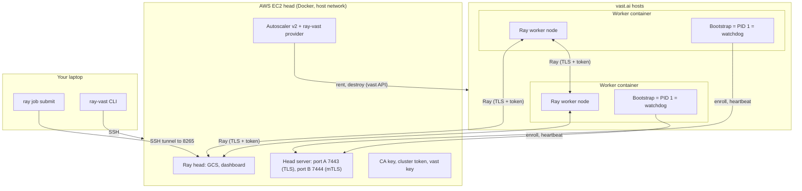

# Architecture

ray-vast runs a Ray cluster with the head on AWS EC2 and the workers on vast.ai containers.
The nodes talk over the public internet, across NAT, with TLS and a token. There is no VPN and no overlay network.

## The head

The head is one EC2 instance in a region that you choose. It runs one Docker container, `ray-vast-head`, with the host network.

- **Why EC2.** A vast instance can stop at any time, and on many hosts its IP can change. If the head stops, the cluster is lost. EC2 gives a stable head.
- **Security groups.** The head's security groups allow SSH from your IP only. They allow the Ray and head server ports from worker IPs only. So a DDoS on the internet can stop single workers, but not the cluster.
- **One image.** The head runs your image plus the ray-vast package (a derived image that `up` builds on the head). So Python and Ray are the same on all nodes.
- **One process does the work.** The provider runs in the Ray monitor process, next to the autoscaler. The head server is a thread in the provider. The provider keeps all its state in memory.
- **No CPU for tasks.** The head declares `CPU: 0`. Tasks and actors with resources run on the workers.

## The provider

The provider is a Ray autoscaler v2 node provider (`ray_vast.provider.VastNodeProvider`).

- When Ray needs a node, the autoscaler asks the provider. The provider makes a slot at once, and rents candidates for it.
- A reconcile pass runs every 10 seconds. It lists the vast instances, adds security group rules for new IPs, ends candidates that pass a time limit, and destroys instances that it does not know (the orphan sweep).
- When the provider starts, it destroys every instance with the cluster label (the start-up sweep). A new head has a new Ray GCS, so old workers cannot join it again.

## The workers

A worker is a vast container that has enrolled and runs Ray.

- The container command is a short bootloader. It downloads the bootstrap from the head, checks its SHA-256, and starts it.
- The bootstrap runs as PID 1. It checks the host, enrolls, starts Ray, and then acts as the watchdog.
- The workers need no sshd. The head never connects to a worker over SSH.

Read [Enrollment and the join token](enrollment.md) and [Worker life cycle and the watchdog](worker-lifecycle.md).

## NAT and the 64 identity ports

A vast container is behind NAT. vast maps some host ports into the container.

Each worker asks vast for 64 ports: the identity ports 70000 to 70063. vast gives a host port P for each, and maps P to the same P in the container.
Ray advertises the public IP of the host and the ports P. So other nodes reach the worker directly.

| Identity port | Use |
|---|---|
| 70000 | Ray node manager |
| 70001 | Ray object manager |
| 70002 | Metrics export |
| 70003 | Dashboard agent gRPC |
| 70004 | Dashboard agent HTTP (job port, 127.0.0.1 only) |
| 70005 | Runtime-env agent (127.0.0.1 only) |
| 70006–70063 | up to 58 Ray worker processes (fewer with a process limit) |

The provider adds `direct_port_count >= 64` to every offer query, so every host can give the 64 ports.
Before a candidate enrolls, the head connects to all 64 ports from outside (the port check).

## The networking shim

Ray binds and connects to the address that it advertises. In a container, that address is the host's public IP, which the container does not own.
Without help, the bind fails (`Errno 99`), and the Ray node stops.

ray-vast loads a small `LD_PRELOAD` library, the shim, into all Ray processes on the head and on the workers:

- A bind to the public IP becomes a bind to the private IP.
- A connect to the node's own public IP becomes a connect to the private IP. So the node does not need hairpin NAT.
- The job port and the runtime-env agent port bind to 127.0.0.1 only. So the token never goes over the network for these ports.

The head sends the shim to each worker when the worker enrolls.

## Head ports

| Port | Use | Open to |
|---|---|---|
| 22 | SSH | Your IP |
| 6379 | Ray GCS | Worker IPs |
| 6380–6383 | Ray node manager, object manager, metrics, agent gRPC | Worker IPs |
| 6384, 6385 | Job port, runtime-env agent | 127.0.0.1 only |
| 8265 | Ray dashboard | 127.0.0.1 only (use `ray-vast dashboard`) |
| 10002–10100 | Ray worker processes | Worker IPs |
| 7443 | Head server: bootstrap, CA, enrollment (TLS) | Worker IPs |
| 7444 | Head server: heartbeat, reports (mTLS) | Worker IPs |

The provider adds one security group rule (all TCP) for each worker IP, before the worker enrolls. It removes the rule when no worker or candidate uses the IP any more.

## The full design

The full specification, with the Ray facts and the worker and head protocol, is in [design.md](https://github.com/duc-ph/ray-vast/blob/main/docs/design.md) on GitHub.
