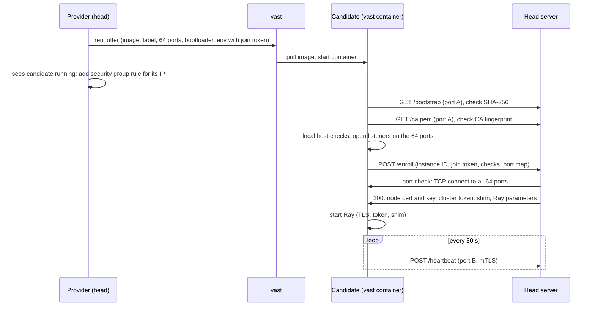

# Enrollment and the join token

A new vast instance has no cluster secrets. Enrollment is the step where it proves its identity to the head and gets them.

## Why workers enroll themselves

vast shows the command and the environment of an instance in its metadata. The container log is at a public URL.
So ray-vast cannot put the cluster secrets in the rental request.

ray-vast does not push secrets over SSH either. That needs sshd, apt and `sudo` in the image, and many images do not have them.

So each worker pulls its secrets from the head, after it proves who it is.

## The steps

1. **Rent.** The provider makes a new join token for each candidate: 32 random bytes. It puts the token in the env of the rental request. The env also has the head IP, the head ports, the SHA-256 of the bootstrap and the SHA-256 of the CA.
2. **Bootloader.** The container command is a short script with no secrets. It finds a Python that can `import ray`, downloads the bootstrap from the head, checks its SHA-256, and starts it as PID 1.
3. **Pin the CA.** The bootstrap downloads the CA certificate and checks its SHA-256 against the value in the env. From then on, it verifies the head with this CA.
4. **Host checks.** The bootstrap checks its host:
    - the egress IP equals the public IP that vast gives;
    - the container has no `NET_RAW` or `NET_ADMIN` capability;
    - the container has its own network namespace;
    - `/dev/shm` is empty.
5. **Enroll.** The bootstrap sends `POST /enroll` with its instance ID, the join token, the check results, its port map, its CPU affinity and CPU quota, and its GPU count.
6. **Head checks.** The head accepts the request only for a known candidate, from its own public IP, with its own join token, once. Then it checks the host check results, the GPU count and the CPU cores. Then it connects to all 64 ports from outside (the port check).
7. **Secrets.** If a slot of the node type is free, the head makes a node key and certificate. It answers with the certificate, the key, the cluster token, the shim and the Ray parameters (the GCS address and the `CPU` of the node type). The worker already has the CA: it pinned it in step 3.
8. **Ray.** The bootstrap removes the secrets from Ray's environment, and starts Ray. Ray joins the head with TLS and the token.

## The join token

The join token proves that an `/enroll` request comes from the instance that the provider rented. It is the same pattern as `kubeadm join --token`.

- The token is valid for one instance ID, only from that instance's public IP, and only for one enrollment.
- It becomes invalid when the instance enrolls, or when the provider ends the candidate.
- The head compares tokens in constant time.
- Nobody logs the token. The bootstrap removes it from the environment of Ray.

Who can read the token: your vast account, your own workers, and the host of the candidate. Co-tenants and the internet cannot. Read [Security model](../security.md).

## Refusals

A refusal before a valid join token destroys nothing: an unknown instance, an instance that already enrolled, a wrong source IP, or a wrong token.
So a stranger cannot kill your candidates with junk requests. The provider's time limits end such candidates.

After a valid token, a failed check destroys the candidate:

| Failure | Blocklist kind for the host |
|---|---|
| Capability, network namespace or `/dev/shm` check | `security`, 30 days |
| A GPU count other than the node type's `GPU` | `security`, 30 days |
| Fewer CPU cores than 90 % of the node type's `CPU` | `security`, 30 days |
| Egress IP check or port check | `network`, 1 day |
| No free slot | none |

The blocklist is in the provider's memory. It is lost at `down`.

## Node certificates

Each node certificate is bound to its instance. It has the worker's public IP and the URI `rayvast:instance/<instance id>`.
On port B, the head checks both. So a worker cannot send heartbeats or reports for another instance.

Each cluster has its own CA and its own cluster token. The CA key stays on the head.
